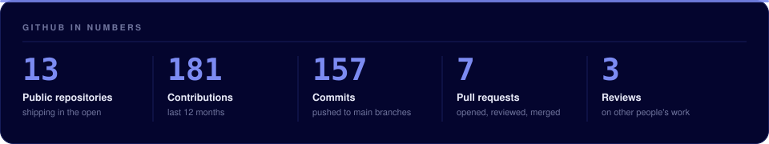
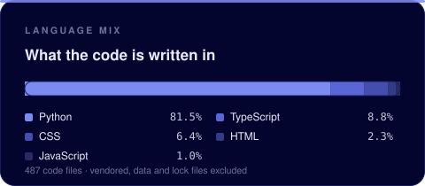
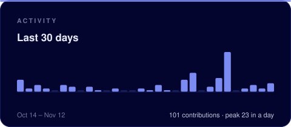
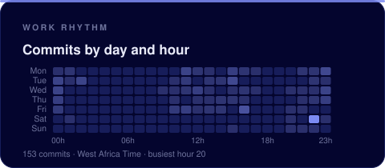
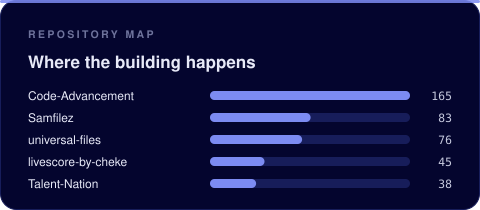

I'm a developer who turns a requirement into a working system: **backend APIs, AI-assisted tools, and interfaces that turn messy information into something you can act on**.

Most of my work is in **Python** and **TypeScript**, and I care about **clear structure, tests that check something real, and code the next person can pick up**.

## 🚀 What I'm Into

- Backend development and clean API design
- Writing tests before the bugs find me
- Applying AI where it saves someone actual time
- Data that answers a question instead of just existing
- Building end to end, from data model to interface

## 🛠️ Tech Stack

### Languages

### Backend & APIs

### Frontend & Apps

### AI & Data

### Tools & Practice

## 📈 Live Activity

## 🌱 Current Focus

I'm currently focused on:

- Going deeper on backend work: APIs, authentication, data modelling
- Using AI on real workflows instead of demos
- Building **LiveScore by Cheke** one feature at a time
- Writing tests earlier, and turning manual checks into automated ones
- Algorithm practice, a few problems at a time

## 🧩 Featured Projects

### 1. [LiveScore by Cheke](https://github.com/Dev-Psalmist/livescore-by-cheke)

A live football scores web app: live matches, fixtures, results, league standings, team pages, match centre, news feed, YouTube highlights and saved favourites. Football data comes through server-side route handlers, so the API key never reaches the browser.

### 2. [ASAKE — VibeCheck AI](https://github.com/Dev-Psalmist/Festival)

A festival feedback detective. It imports audience reviews from CSV, validates and stores them, then uses Gemini to read sentiment, emotion, recurring topics and complaint categories, compares festivals against each other and exports intelligence reports. AI predictions are scored against a hand-labelled gold-standard set: 83.3% sentiment accuracy and 100% complaint-category accuracy on 12 examples.

### 3. [CampusFlow — Ticket Intelligence](https://github.com/Dev-Psalmist/CLI-TICKET-CampusFlow)

A campus helpdesk that does more than store tickets: duplicate detection, classification against historical tickets, an AI assistant on top of the queue, a campus news feed and generated reports. Built as a tested Python application with a Streamlit interface.

### 4. [E-Commerce Backend API](https://github.com/Dev-Psalmist/BE-SECTION-1-MISSION-E-Commerce-Backend-API---Team)

A RESTful backend for an e-commerce platform: product management, user registration, secure login and authenticated order creation. Argon2 password hashing, JWT auth, Pydantic validation and a layered structure of routes, schemas and security modules.

## 🧱 More Builds

| Project | What it does | Stack |
|---|---|---|
| [TournamentLab](https://github.com/Dev-Psalmist/ESports-League-Manager) | Round-robin tournament manager for NPFL clubs: fixtures, results, standings, match simulation | Python |
| [Mystery Island: The Lost Lighthouse](https://github.com/Dev-Psalmist/Mystery-Island) | Textbook text adventure built as a first real program, with `unittest` coverage | Python |
| [Talent-Nation](https://github.com/Dev-Psalmist/Talent-Nation) | 38 focused algorithm drills: trees, graphs, brackets, intervals, searching | Python |
| [universal-files](https://github.com/Dev-Psalmist/universal-files) | Data visualisation practice: world GDP, population, generated charts | Python, Matplotlib |
| [Samfilez](https://github.com/Dev-Psalmist/Samfilez) | Playground where most of my Python basics got worked out: classes, files, small games | Python, Pygame |

## 🔗 Connect With Me

- GitHub: [Dev-Psalmist](https://github.com/Dev-Psalmist)
- Email: [ogahsamsonogah@gmail.com](mailto:ogahsamsonogah@gmail.com)

## ✨ Closing Note

**LEARNING IN PUBLIC.**
**BUILDING WITH PURPOSE.**
**SHIPPING WHAT WORKS.**

 

*Thanks for stopping by. The commit history is the honest version of the story.* 🚀

© 2026 Dev Psalmist

